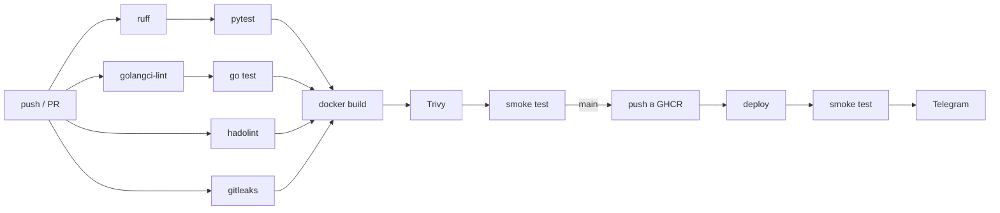
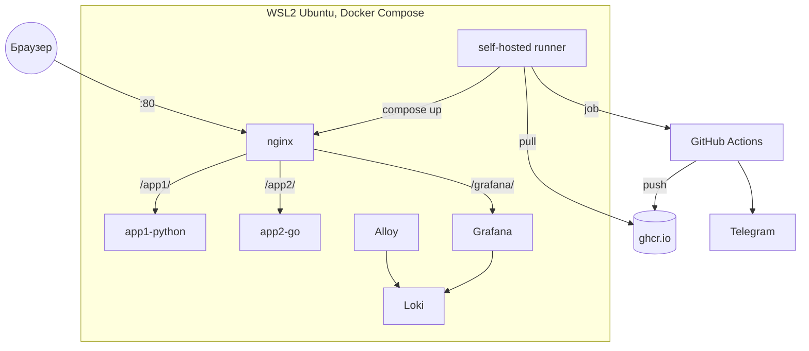

# DevOps Exam

Два web-приложения с автоматической сборкой и деплоем через GitHub Actions.

| Приложение | Стек | Ответ на `/` | Порт |
|---|---|---|---|
| `app1-python` | Python 3.12, Flask, gunicorn | `Hello World 1` | 8000 |
| `app2-go` | Go 1.23, gin | `Hello World 2` | 8080 |

## Стек

- SCM: GitHub
- CI/CD: GitHub Actions
- Registry: GHCR (`ghcr.io`)
- Инфраструктура: WSL2 (Ubuntu), Docker, Docker Compose, self-hosted runner
- Reverse proxy: nginx
- Логи: Grafana Alloy, Loki, Grafana
- Секреты: GitHub Secrets
- Уведомления: Telegram
- Проверки: ruff, golangci-lint, hadolint, gitleaks, Trivy, pytest, go test

## Структура

```
app1-python/              Flask-приложение, тесты, Dockerfile
app2-go/                  gin-приложение, тесты, Dockerfile
deploy/                   docker-compose, nginx, конфиги логирования
.github/workflows/
  ci-cd.yml               основной pipeline
  registry-cleanup.yml    очистка старых образов в GHCR
```

## Pipeline

Запускается на push в `main`, на pull request и вручную.



1. Lint: ruff, golangci-lint, hadolint, gitleaks.
2. Test: pytest, go vet, go test.
3. Build: сборка образов, тег `sha-<commit>` и `latest`.
4. Scan: Trivy, падение на CRITICAL/HIGH.
5. Smoke test запущенного контейнера.
6. Push в GHCR (только `main`).
7. Deploy на self-hosted runner: `docker compose pull && docker compose up -d`.
8. Smoke test после деплоя.
9. Уведомление в Telegram.

`registry-cleanup.yml` раз в неделю удаляет untagged-образы и оставляет 10 последних версий.

## Инфраструктура



## Установка

WSL (PowerShell от администратора, потом перезагрузка):

```powershell
wsl --install -d Ubuntu
```

Docker в Ubuntu:

```bash
curl -fsSL https://get.docker.com | sudo sh
sudo usermod -aG docker "$USER"
```

Runner: Settings → Actions → Runners → New self-hosted runner → Linux x64, при `config.sh` добавить `--labels wsl`, затем:

```bash
sudo ./svc.sh install "$USER"
sudo ./svc.sh start
```

## Переменные и секреты

| Тип | Имя | Описание |
|---|---|---|
| Variable | `DEPLOY_ENABLED` | `true` включает деплой |
| Variable | `HTTP_PORT` | порт nginx, по умолчанию 80 |
| Variable | `DEPLOY_DIR` | каталог стека, по умолчанию `~/devops-exam` |
| Secret | `GRAFANA_ADMIN_PASSWORD` | пароль Grafana |
| Secret | `TELEGRAM_BOT_TOKEN` | токен бота |
| Secret | `TELEGRAM_CHAT_ID` | id чата |

## Проверка

- `http://localhost/app1/` → `Hello World 1`
- `http://localhost/app2/` → `Hello World 2`
- `http://localhost/app1/health` → версия сборки
- `http://localhost/grafana/` → логи в Loki

## Локальный запуск

```bash
cd app1-python && pip install -r requirements-dev.txt && pytest
cd app2-go && go mod tidy && go test ./...
docker build -t app1 app1-python && docker run --rm -p 8000:8000 app1
docker build -t app2 app2-go && docker run --rm -p 8080:8080 app2
```
